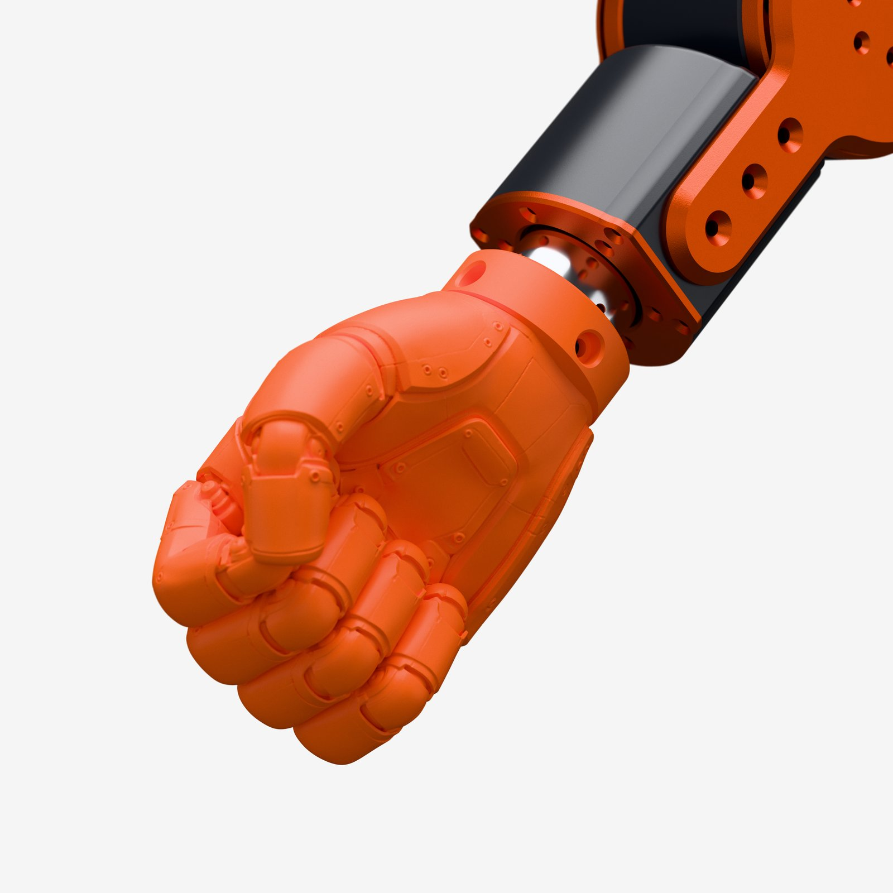
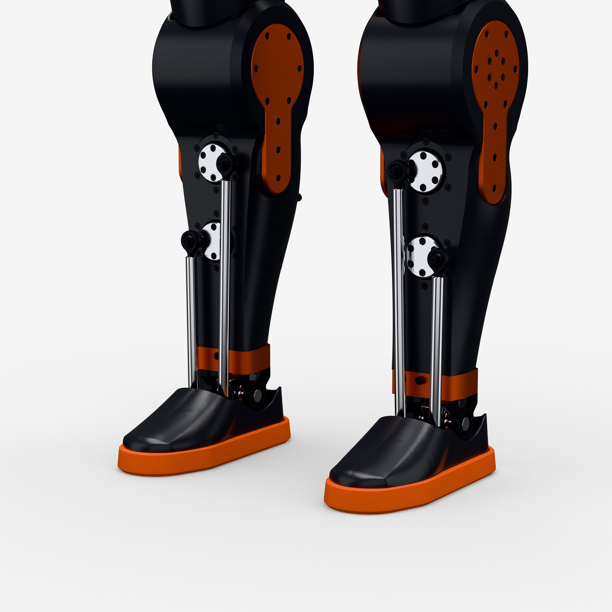
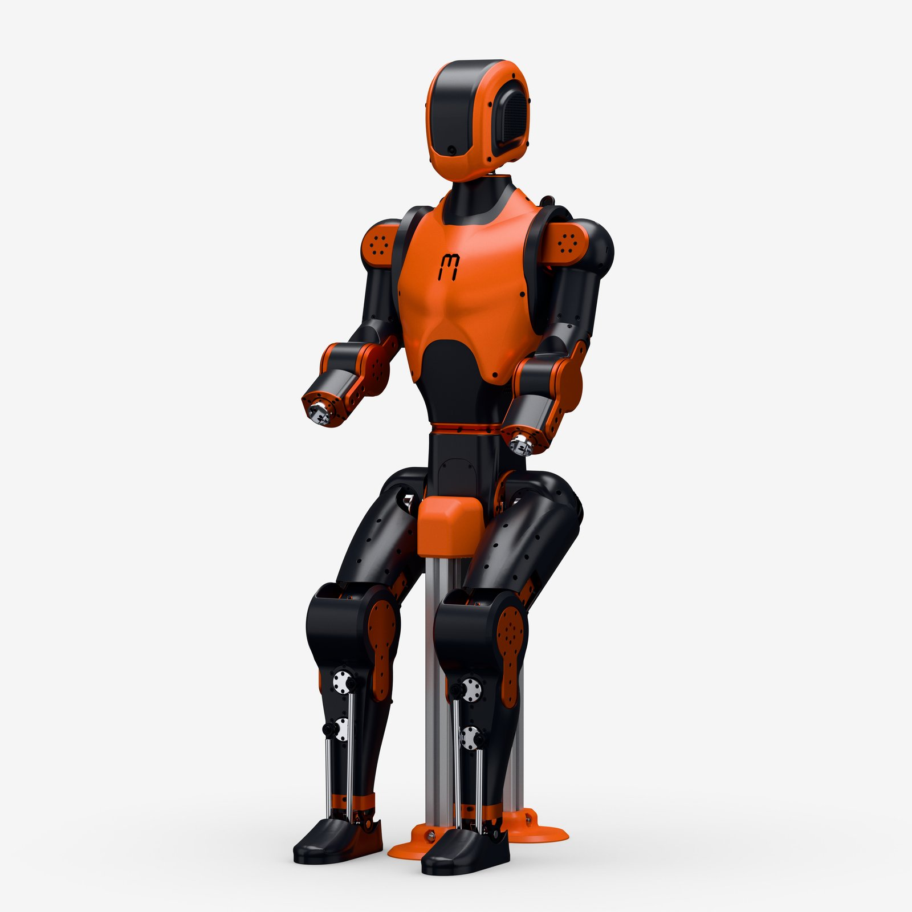

[Asimov 1](../../README.md) / Accessories

# Asimov 1 Accessories

We use these on our own Asimov 1 robots. Print them, build them, change them.

| [Asimov 1 Dummy Hands](dummy_hands/README.md) | [Asimov 1 Shoes](shoes/README.md) | [Asimov 1 Chair](chair/README.md) |
|---|---|---|
|  |  |  |
| Dummy fists for the open wrists. A print-ready Bambu Studio project. | TPU shoes that stop the robot slipping on smooth floors. One file for both feet. | Where the robot sits when it isn't walking, and the easiest way to store it. |

## Don't have an Asimov 1 yet?

Asimov 1 is sold as a DIY kit. The kit doesn't include these accessories, so you print or build them yourself from the files here.

**[Order the Asimov 1 DIY Kit →](https://menlo.ai/asimov-1#buy)**

## Download

The 3MF and STEP files are stored with Git LFS. Open a file on GitHub and use the download button to get the full file. If you clone the repository, run `git lfs install` first.

## Also open

[OpenCrane](https://github.com/menloresearch/opencrane), the crane that holds Asimov 1 during testing.

## License

Same as the robot, [CERN-OHL-S-2.0](../../HARDWARE-LICENSE.txt).
