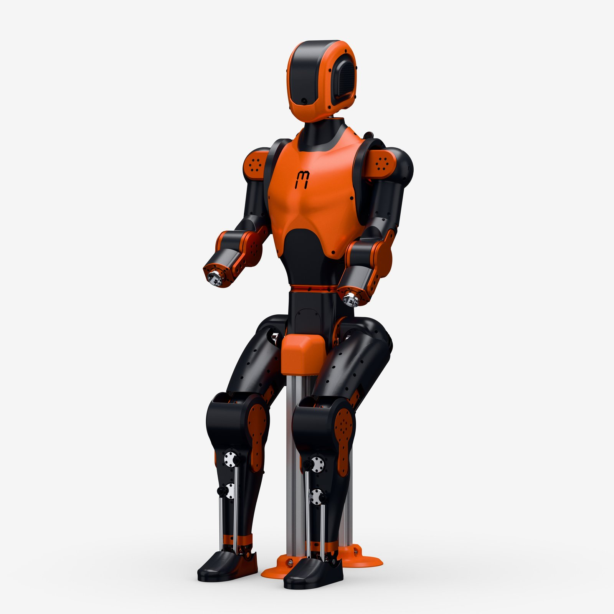
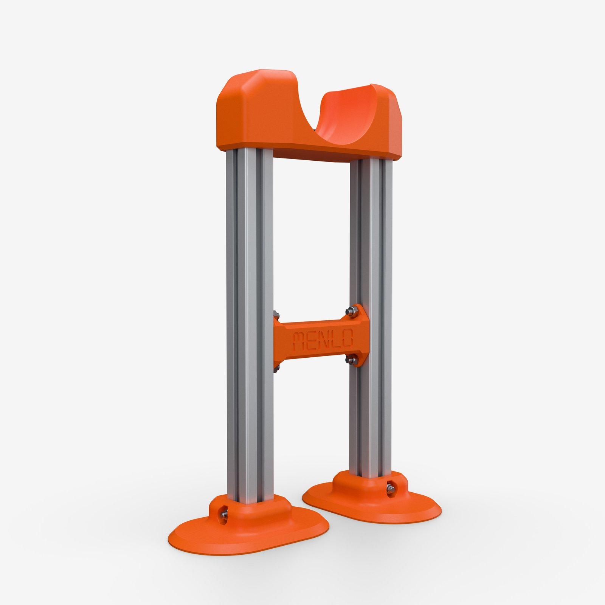
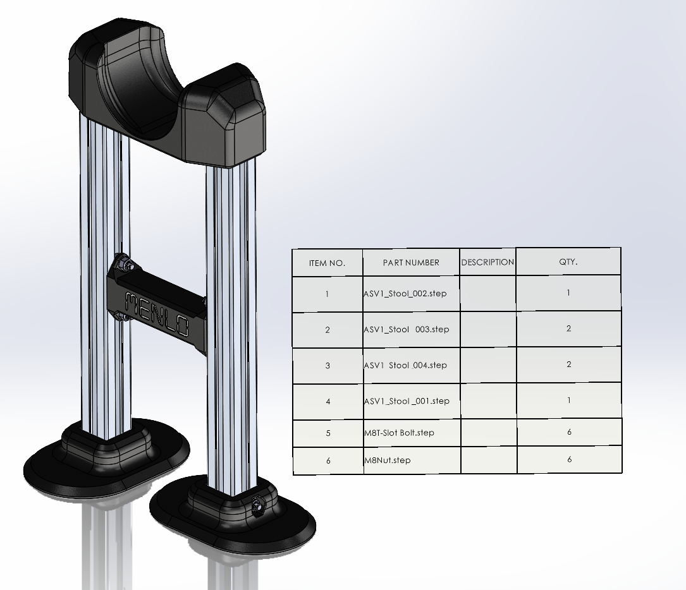

[Asimov 1](../../../README.md) / [Accessories](../README.md) / Chair

# Asimov 1 Chair

Asimov 1 sits on the Chair when it isn't walking. It's the easiest way to store the robot, and you can work on it without a crane.

  
  

Internally we call it the stool, so the part files keep their `ASV1_Stool` names. The assembly finds its parts by these names, so please don't rename them.

## Files

- [BOM.csv](BOM.csv): editable parts list with quantities, manufacturing specifications, CAD paths, and supplier links.
- [cad/ASV1_Stool.STEP](cad/ASV1_Stool.STEP): assembly referencing the six component STEP files in the same directory.
- [docs/ASV1_StoolBOM.png](docs/ASV1_StoolBOM.png): original assembly rendering and quantity table.
- [docs/sourcing.pdf](docs/sourcing.pdf): original off-the-shelf fastener sourcing sheet.
- [preview/ASV1_Stool.HTML](preview/ASV1_Stool.HTML): supplied eDrawings browser viewer; download it and open it in a browser. GitHub's file page does not run the viewer.

The STEP files were exported as AP214 from SolidWorks 2025 on 2026-09-24 and declare millimetres as their length unit. The package includes neutral STEP exports; native SolidWorks source files were not supplied.

## Fabrication and purchasing

| Part | Quantity per Chair | Specification |
|---|---|---|
| `ASV1_Stool_001` | 1 | FDM printed in PLA or PETG; settings below |
| `ASV1_Stool_002` | 1 | FDM printed in PLA or PETG; settings below |
| `ASV1_Stool_003` | 2 | FDM printed in PLA or PETG; settings below |
| `ASV1_Stool_004` | 2 | Aluminium extrusion, **40 × 40 mm**, cut to **500 mm**; **no end machining** |
| M8 T-slot bolt | 6 | [McMaster-Carr 91523A231](https://www.mcmaster.com/91523A231/) |
| M8 nut | 6 | [McMaster-Carr 90631A115](https://www.mcmaster.com/90631A115/) |

There are four printed pieces in total: one each of components 001 and 002, and two of component 003. The two aluminium extrusions are cut stock. Bolts and nuts are purchased hardware.

### Print settings

Use these settings for all printed components (001–003):

| Setting | Value |
|---|---|
| Manufacturing process | FDM 3D printing |
| Material | PLA or PETG |
| Layer height | 0.28 mm maximum |
| Wall count | 10 |
| Top layers | 4 |
| Bottom layers | 4 |
| Infill | 20%, grid pattern |
| Supports | None required |

Refer to the assembly image above for part placement.

## Opening the CAD

1. Download the complete `cad/` directory with its Git LFS content.
2. Open `cad/ASV1_Stool.STEP` in a CAD application supporting STEP external references.
3. If prompted for missing components, select the matching files in the same `cad/` directory. The original component filenames, including spaces and `.step.STEP` suffixes, are preserved because the assembly references them by name.

The assembly file contains component placements and external references rather than embedded solid geometry, with **18 component instances** listed in the BOM.

## License

This accessory has its own BOM, separate from the robot fabrication manifest. See the repository [hardware license](../../../HARDWARE-LICENSE.txt).

---

**More accessories** [Asimov 1 Display Hands](../display_hands/README.md), [Asimov 1 Shoes](../shoes/README.md), [all accessories](../README.md)

Don't have an Asimov 1 yet? It's sold as a DIY kit, without these accessories. [Order the Asimov 1 DIY Kit →](https://menlo.ai/asimov-1#buy)
