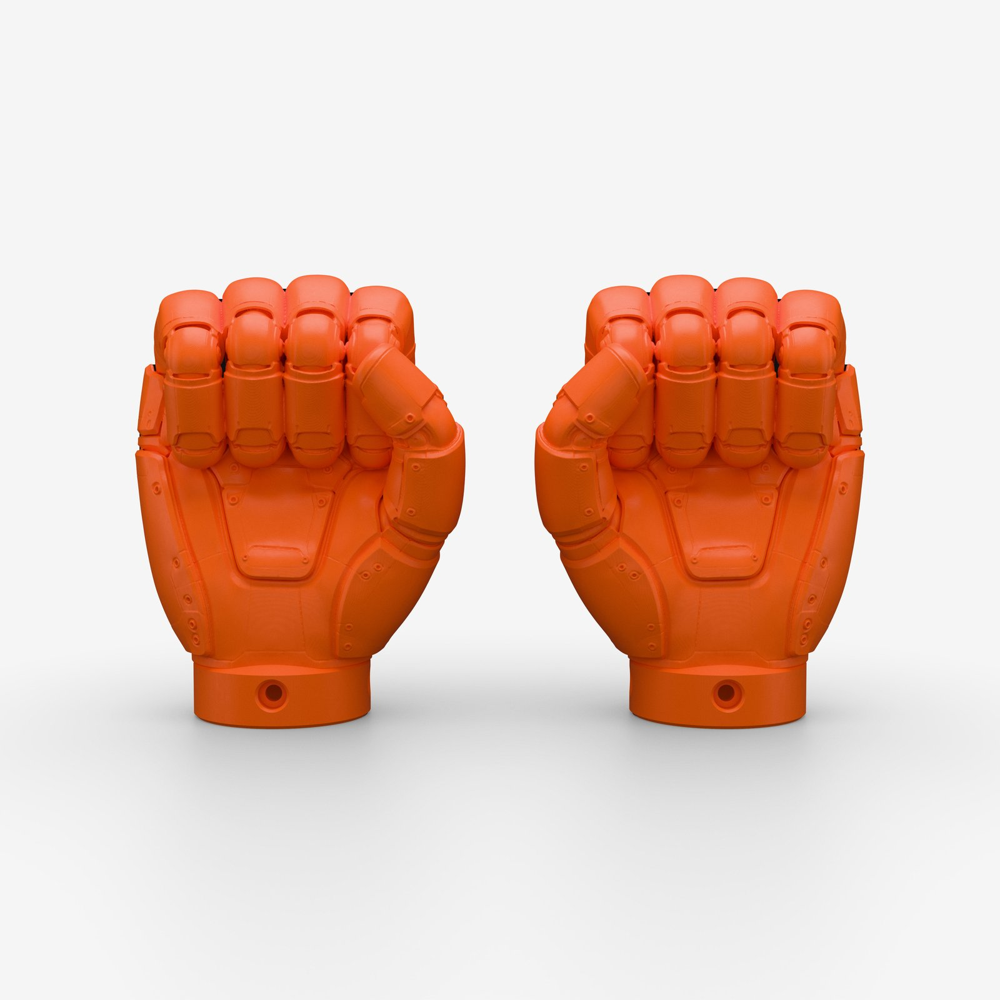
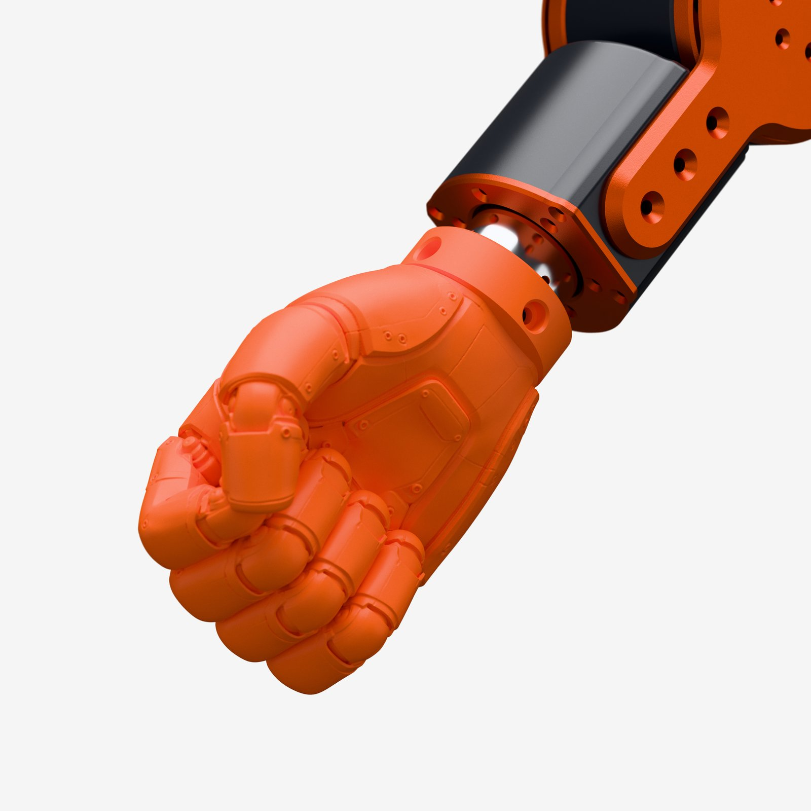

[Asimov 1](../../../README.md) / [Accessories](../README.md) / Dummy Hands

# Asimov 1 Dummy Hands

Dummy fists for Asimov 1. The DIY kit ships without hands, and these cover the open wrists until you mount a gripper or a hand of your own.

  
  

[ASV1_DUMMY_HANDS.3mf](ASV1_DUMMY_HANDS.3mf) is the supplied print-ready Bambu Studio project for the dummy hands. It contains the models, plate layout, and printer, filament, and print settings.

## Printing

1. Download the complete `.3mf` file with its Git LFS content.
2. Open it in **Bambu Studio as a project** to load the embedded settings and plate layout.
3. Use the saved project settings to slice and print the hands. The supplied project uses a **Bambu Lab P1S with a 0.4 mm nozzle** and **PLA** filament settings.

See the repository [hardware license](../../../HARDWARE-LICENSE.txt).

---

**More accessories** [Asimov 1 Shoes](../shoes/README.md), [Asimov 1 Chair](../chair/README.md), [all accessories](../README.md)

Don't have an Asimov 1 yet? It's sold as a DIY kit, without these accessories. [Order the Asimov 1 DIY Kit →](https://menlo.ai/asimov-1#buy)
