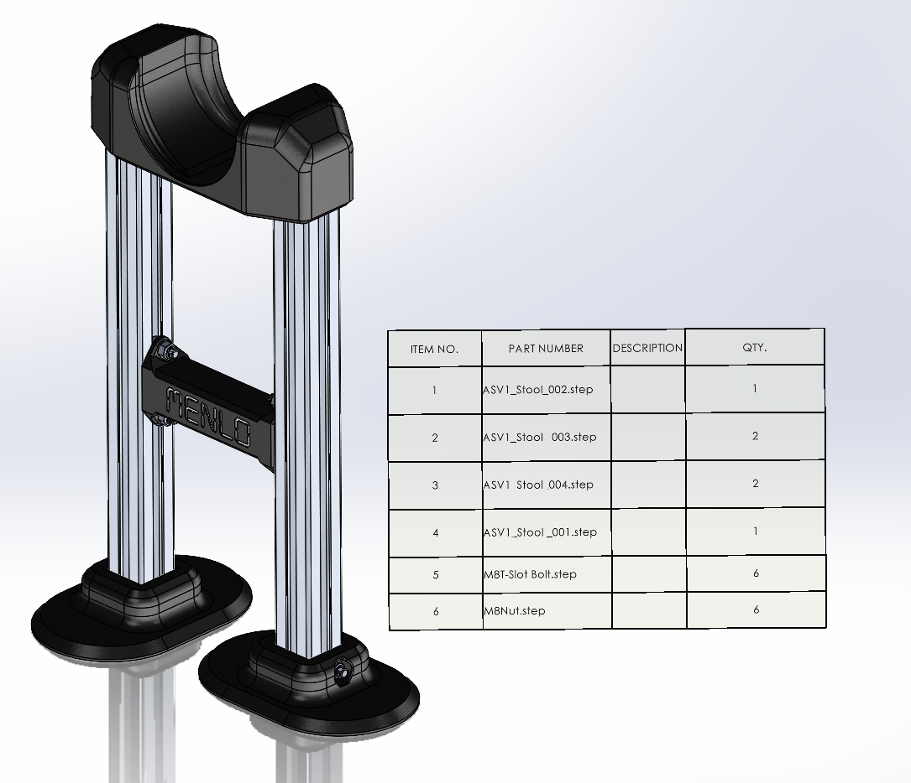

# Asimov 1 stool

CAD, parts inventory, and fabrication information for the Asimov 1 support stool.

## Files

- [BOM.csv](BOM.csv): editable parts list with quantities, manufacturing specifications, CAD paths, and supplier links.
- [cad/ASV1_Stool.STEP](cad/ASV1_Stool.STEP): assembly referencing the six component STEP files in the same directory.
- [docs/ASV1_StoolBOM.png](docs/ASV1_StoolBOM.png): original assembly rendering and quantity table.
- [docs/sourcing.pdf](docs/sourcing.pdf): original off-the-shelf fastener sourcing sheet.
- [preview/ASV1_Stool.HTML](preview/ASV1_Stool.HTML): supplied eDrawings browser viewer; download it and open it in a browser. GitHub's file page does not run the viewer.

The STEP files were exported as AP214 from SolidWorks 2025 on 2026-09-24 and declare millimetres as their length unit. The package includes neutral STEP exports; native SolidWorks source files were not supplied.

## Fabrication and purchasing

| Part | Quantity per stool | Specification |
|---|---|---|
| `ASV1_Stool_001` | 1 | 3D printed; material and printing process/settings TBC |
| `ASV1_Stool_002` | 1 | 3D printed; material and printing process/settings TBC |
| `ASV1_Stool_003` | 2 | 3D printed; material and printing process/settings TBC |
| `ASV1_Stool_004` | 2 | Aluminium extrusion, **40 × 40 mm**, cut to **500 mm**; **no end machining** |
| M8 T-slot bolt | 6 | [McMaster-Carr 91523A231](https://www.mcmaster.com/91523A231/) |
| M8 nut | 6 | [McMaster-Carr 90631A115](https://www.mcmaster.com/90631A115/) |

There are four printed pieces in total: one each of components 001 and 002, and two of component 003. The two aluminium extrusions are cut stock. Bolts and nuts are purchased hardware.

The extrusion's slot/profile series, alloy/grade, and supplier part number still need confirmation. A 40 × 40 mm outside dimension alone does not identify a compatible slot profile.

## Opening the CAD

1. Download the complete `cad/` directory with its Git LFS content.
2. Open `cad/ASV1_Stool.STEP` in a CAD application supporting STEP external references.
3. If prompted for missing components, select the matching files in the same `cad/` directory. The original component filenames, including spaces and `.step.STEP` suffixes, are preserved because the assembly references them by name.

The assembly file contains component placements and external references rather than embedded solid geometry. Check that the CAD application loads all **18 component instances** listed in the BOM. CAD-application import validation and a self-contained assembly export remain pending.

## Details to complete

- Material, printing process, and print parameters for components 001–003.
- Exact aluminium extrusion profile, alloy/grade, and supplier reference.
- Assembly sequence, fastening details, and robot positioning instructions.
- Compatible robot revision and documented supported load / validation results.

`TBC` in the BOM identifies a specification that has not been supplied. The shoe's TPU 95A specification applies to the shoe soles; the stool's printed-part material is still TBC.

## Source package and storage

These files originate from `ASV1_StoolParts.zip`. The assembly STEP has been placed alongside its component STEP files so its filename references can resolve locally. The CAD contents are unchanged. The separate `ASV1_Stool.HTML` supplied with the ZIP was identical to the embedded viewer, so this directory includes one viewer copy.

STEP files use the repository's Git LFS rule. The BOM, documentation, and viewer use ordinary Git. Keep the source ZIP in the local ignored `temp/` directory; the extracted files here are the versioned package.

This accessory has its own BOM, separate from the robot fabrication manifest. See the repository [hardware license](../../../HARDWARE-LICENSE.txt).
